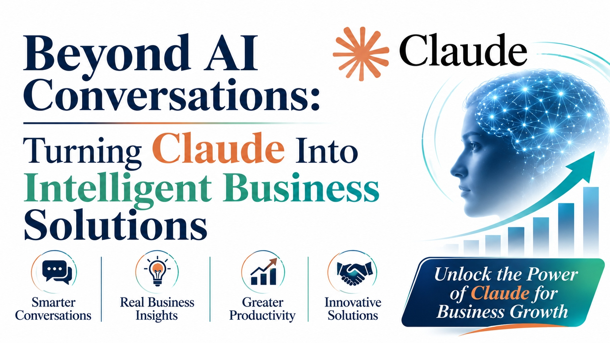

Beyond AI Conversations: Turning Claude Into Intelligent Business Solutions



A good conversation with an AI assistant ends with an answer. A good business solution ends with something done: a case resolved, a document reviewed, a report delivered. The gap between the two is not a better prompt. It is the work of connecting the model to your information, your systems, and your rules.

That connecting work is what teams buy when they invest in [Claude API Integration Services](https://zignuts.com/ai-services/ai-integration/claude-integration-services?utm_source=seo_web2.0&utm_medium=backlink&utm_campaign=seo_referral&utm_id=11): context the model can trust, tools it is allowed to use, checks that catch mistakes, and monitoring that keeps cost and quality visible.

This kit gives you a short test, a one-page canvas, and a launch checklist for turning a promising conversation into a dependable solution.

---

## The Conversation-to-Solution Test

Ask these four questions about any idea before you build it.

1. **What gets done at the end?** Name the outcome, not the answer.
2. **What does the model need to know?** List the sources, and who keeps them current.
3. **What may it touch?** List the systems and actions, and which need a person's approval.
4. **How will we know it worked?** Choose one measure and record a baseline.

## One-Page Solution Canvas

```
Task:            [what the business needs done]
User:            [who asks, and in what situation]
Context:         [documents, records, and history it may use]
Instructions:    [role, tone, and rules it must follow]
Tools:           [systems it may read from or act on]
Human check:     [what a person reviews or approves]
Measure:         [the number that proves value]
Fallback:        [what happens when it is unsure or unavailable]
```

## Four Pillars of Value

| Pillar | What the business gains | How to measure it |
|---|---|---|
| **Smarter conversations** | Answers grounded in company knowledge | Share of answers accepted without edits |
| **Real business insights** | Findings drawn from documents and data | Time from question to usable insight |
| **Greater productivity** | Routine work finished faster | Hours saved on the targeted task |
| **Innovative solutions** | New services built around the model | Adoption and paid use |

## Pitfalls to Avoid

- Judging the solution by how fluent it sounds, not by what gets done
- Giving the model more access than the task needs
- Skipping a human check on actions with real consequences
- Launching without a fixed set of test examples
- Leaving cost unmeasured until the first large bill

## Launch Checklist

- [ ] The canvas is complete and agreed
- [ ] A baseline is recorded
- [ ] Access follows each user's existing permissions
- [ ] Test examples are scored on every change
- [ ] A fallback exists for slow or unavailable service
- [ ] A named owner reviews quality and cost each week

---

**Ready to turn conversations into business solutions?** Visit [zignuts.com](https://zignuts.com/?utm_source=seo_web2.0&utm_medium=backlink&utm_campaign=seo_referral&utm_id=11) to speak with the team.
